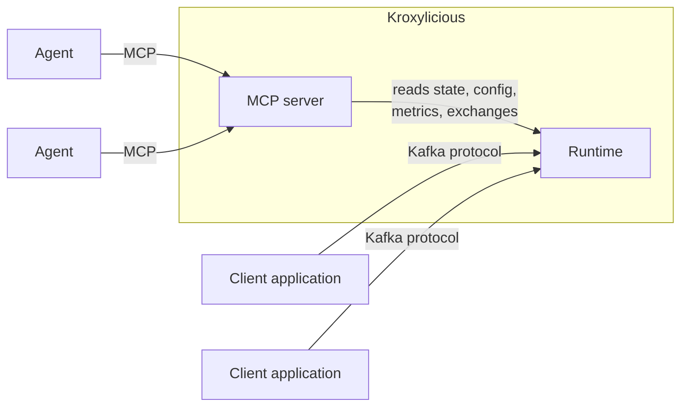

The Kroxylicious team ([https://github.com/orgs/kroxylicious/people](https://github.com/orgs/kroxylicious/people)) recently held an innovation day, a chance to step away from the roadmap and play with concepts that might be worth adding to the proxy one day. [k-wall](https://github.com/k-wall), [henryZrncik](https://github.com/henryZrncik), [AdityaThakur1998](https://github.com/AdityaThakur1998) and I decided to find out what it would mean to give Kroxylicious an MCP server, and what that would let us do.

What follows is a proof of concept and nothing more. None of it is production code, and part of the fun was giving ourselves permission to drop code in without worrying about auth, error handling or any of the things we'd normally insist on. We wanted to see how far we could get in a day, not ship something. The code we wrote is at [https://github.com/MarkNSweep/kroxylicious/tree/mcp-poc](https://github.com/MarkNSweep/kroxylicious/tree/mcp-poc).

There was a serious question underneath the play, though. Kroxylicious sits on the wire between Kafka clients and their clusters, so it already sees a lot of what's going on. If an agent could ask the proxy what it knows, could it answer two questions users often ask: is the proxy healthy, and why isn't my application working ?

## What we built

The idea is simple. The proxy already has a runtime that knows its own state, its configuration and its metrics. An MCP server sitting alongside that runtime can expose those as tools, and an agent can call them to reason about what the proxy is seeing. Client applications carry on talking Kafka to the runtime as they always have. The agents talk MCP to the MCP server, and the MCP server asks the runtime for whatever the agent wants to know.






The first step was to add MCP protocol support using Netty, and have it start alongside the proxy. There's no authentication, as this is a proof of concept and we wanted to spend the day exploring rather than wiring up security. With the server running, we challenged ourselves to see whether an agent could answer questions about the proxy at all.

To make the answers worth having, we needed the proxy to record a bit more about what its clients were doing. We added a simple internal filter that records the client id an application uses when it makes requests, and exposed that through a tool. The purpose was to associate applications with connections, so activity could be correlated back to a named application rather than an anonymous socket. We also exposed the proxy's existing metrics as tools, so the agent could read the same numbers an operator would look at.

By the end of the day the MCP server offered the following tools.

Proxy introspection:

- `get_proxy_status` gets the current status, lifecycle state and uptime of the proxy.
- `get_proxy_config` gets the current proxy configuration.
- `list_virtual_clusters` lists the configured virtual clusters, gateways and target clusters.
- `list_filter_definitions` lists the configured filter definitions and default filters.
- `list_connected_clients` lists the client ids of currently connected clients, with the time each client's `ApiVersions` request was seen.

Metrics:

- `get_metrics_summary` summarises the registered metrics, their types and labels, so the agent can discover what's available.
- `get_metric` gets the current value of one metric series by name and labels.
- `get_connection_metrics` gets the client-to-proxy and proxy-to-server connection counts, active connection gauges, errors and client disconnects.
- `get_message_metrics` gets the Kafka request and response counts and size distributions on both sides.
- `get_reconfiguration_metrics` gets the reconfiguration outcomes, duration and per-cluster operation outcomes.
- `get_virtual_cluster_lifecycle_metrics` gets the current state of each virtual cluster, time spent in each state and the transition counts.
- `get_authentication_metrics` gets the client authentication outcomes by virtual cluster and mechanism.

Diagnostics:

- `get_client_exchanges` gets the last five request and response exchanges for every connection made by a named application. More on this one below, as it's the tool that made the difference.

## Is the proxy healthy ?

The first question we put to the agent was the obvious one.

> what is the health of Kroxy

**The agent replied**:

The proxy is up and idle. I only have a summary view, so I can't see the actual metric values.

- **State:** `STARTED`
- **Clients:** none connected.
- **Memory:** about 24 MB of heap is committed out of a 2.6 GB maximum, and about 4.4 MB of that is free. That is normal for a JVM that has just started and has little load, because the heap grows on demand.
- **CPU:** 9 processors are available.
- **JRE:** version 27.

That's a reasonable answer from the handful of tools it had at that point. The agent read the state, noticed nothing was connected, and was honest about the fact that it only had a summary view of the metrics rather than the values themselves.

## Why isn't my application working ?

The more interesting question is the diagnostic one, so we took a Kafka application that was failing and asked the agent to work out why. We'd set the application up to fail by giving it an invalid password for the SASL exchange, so the real answer was an authentication failure.

> I have a Kafka application called producer which is failing to send messages to Kafka, why is that?

**The agent answered**:

I can't say yet why the producer fails. The proxy shows no evidence that the producer ever reached it.

**What I verified from the proxy**

- The proxy state is `STARTED`.
- Virtual cluster `demo` is `serving`. It has one gateway, `sni`, and uses direct routing. It never entered `failed`.
- There are no connected clients.
- The message metrics are empty, so no Kafka requests have been seen.
- The authentication metrics are empty, so no SASL attempts have been made.
- There is one connection metric, `client_to_proxy_errors`, and it is 0. It is tagged `virtual_cluster=""` and `node_id=bootstrap`. That tag set means a connection arrived without matching any virtual cluster.
- No filters are configured. Filters aren't blocking the producer.

**Likely causes**

The producer fails before it reaches the proxy. The cause is probably one of these:

1. **Wrong bootstrap address.** The `sni` gateway is `sniHostIdentifiesNode`. It only accepts TLS connections whose SNI is `bootstrap.dev.kroxy.test:19192`. The producer must use that exact name and port. Using `localhost:9192` or the Kafka address `kafka.kroxy.test:9094` won't work.
2. **DNS can't resolve the name.** `bootstrap.dev.kroxy.test` and `broker-<n>.dev.kroxy.test` must both resolve to the proxy. The `broker-<n>` names matter because the proxy advertises them after the first metadata call. The symptom is that the producer bootstraps and then times out on metadata or on send.
3. **The producer uses plaintext, or doesn't trust the CA.** The gateway requires TLS. The producer needs `security.protocol=SSL` and a truststore containing the CA that issued `/certs/tls.crt`. The certificate must also cover both the `bootstrap.dev.kroxy.test` and `*.dev.kroxy.test` names.
4. **A named-groups mismatch.** The gateway only allows `X25519MLKEM768` and `secp256r1`. A producer whose JVM supports neither group can't complete the handshake. This is plausible, because the config is named `namedgroups`. A JRE older than 24 can't offer `X25519MLKEM768`, so it would have to use `secp256r1`.
5. **The producer isn't running or isn't pointed at this proxy.** `list_connected_clients` is empty.

**What I need**

- The producer's `bootstrap.servers` and `security.protocol` settings.
- The producer's exception, such as a timeout or SSL handshake error.
- The producer's Java version.

With those I can narrow it to one cause.

This is a good answer in that it's thorough and it's honest, however it's wrong. The agent reasoned that the application had never reached the proxy, as there was no record of it having done so, and went off down a list of connectivity causes. The real failure, an invalid SASL password, isn't on the list. The agent couldn't see it, as the proxy wasn't keeping any record of the exchanges it had actually handled.

So we gave it that record. We added another internal filter, this one recording the last five request and response exchanges from each client, and exposed it through the `get_client_exchanges` tool. This filter would need a lot of work before anyone could take it seriously for production (holding request and response history per connection has obvious cost and lifecycle questions), but as this was a proof of concept it was all good, and it let us test the idea in an afternoon.

We asked again.

> I have a Kafka application called myapp which is failing to send messages to Kafka, why is that?

**This time the agent replied**:

`myapp` is failing SASL authentication on the `demo` virtual cluster due to invalid credentials.

### Details from exchange history

1. **Handshake:** `myapp` negotiates SASL mechanism `SCRAM-SHA-512`.
2. **Authentication failure:** The proxy rejects the second `SASL_AUTHENTICATE` request with error code `58` (`SASL_AUTHENTICATION_FAILED`):

   ```
   Authentication failed during authentication due to invalid credentials with SASL mechanism SCRAM-SHA-512
   ```

3. **Impact:** The connection terminates immediately after authentication failure, preventing `myapp` from sending `PRODUCE` or metadata requests.

### Next steps

Check the username and password configured in `myapp`'s SASL JAAS config or credential store and ensure they match the credentials registered for SCRAM-SHA-512 authentication.

That's the answer we were after. With the exchange history available, the agent went straight to the cause, named the mechanism, quoted the error, and told the user where to look. The one extra tool is the whole difference between the two attempts. The agent's reasoning was sound both times, it just needed the proxy to tell it what had happened.

We retried the health question too, now that there was more for the agent to read.

> what is the health of kroxy?

**The agent replied**:

Kroxylicious is **healthy and operational**.

### Status summary

- **Proxy state:** `STARTED` (JRE 27, 9 available processors, ~39.8 MB heap allocated out of 2.6 GB max)
- **Virtual cluster (`demo`):** `SERVING` (1.0)
- **Errors:** `0` internal client-to-proxy errors, `0` proxy-to-server errors
- **Connections:**
  - Active downstream: `0`
  - Active upstream: `0`
  - Total connections handled: `81` (all past disconnections resulted from normal client closes or auth failure teardowns)

With the connection metrics and exchange history to draw on, the health answer is richer than the first one. It can now talk about how many connections have been handled and account for how they ended, rather than just reporting that nothing is connected right now.

## What we learned

The thing that stood out is how closely the quality of the answer tracked the tools we gave the agent. The reasoning was capable throughout. What held it back on the first diagnostic attempt was that the proxy simply wasn't recording the information needed to answer the question. As soon as it was, the agent found the problem on its own. Kroxylicious is in an unusual position here, as it sees both sides of every conversation, so the more of what it sees it's willing to expose, the more an agent can do with it.

To recap, in one day we set out to explore what MCP could add to Kroxylicious, added an MCP server that starts with the proxy, wrote a couple of internal filters to record the client id and recent exchanges, and used an agent to answer the two questions users frequently ask: is the proxy healthy, and why isn't my application working. None of it is production quality, and it was all the more enjoyable for not having to be.

## Over to you

We'd like to know how interested people would be in adding MCP capabilities to the Kroxylicious project, and what problems you think it would help you solve. If an agent that could ask the proxy what it knows would be useful to you, we'd like to hear about it.
